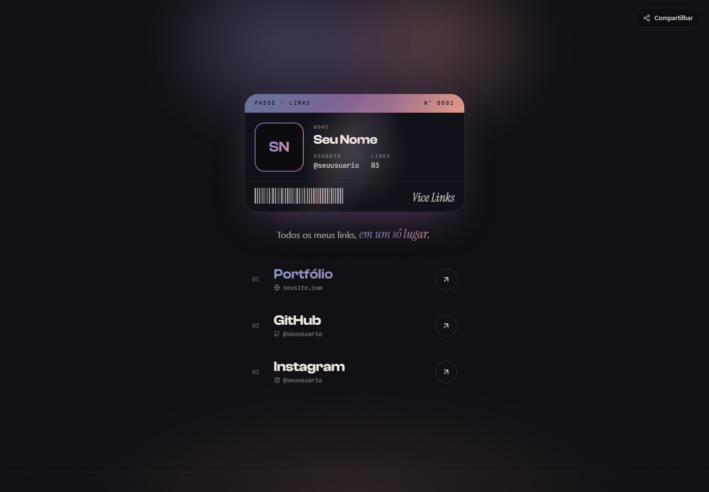

<h1>Vice Links</h1>

Página de links para a bio, com visual de cartão de identificação em clima de pôr do sol

---

## Sobre

Página que reúne links (portfólio, GitHub, Instagram e o que mais quiser) em um só lugar, pensada para a bio das redes sociais.

Em vez do visual padrão de lista de botões, o perfil vira um cartão de identificação com degradê de azul, roxo e pêssego, e os links aparecem numerados em estilo editorial.

## Destaques

- **Cartão de identificação** com foto, código de barras gerado a partir do @ e reflexo holográfico
- **Inclinação 3D** do cartão acompanhando o mouse no desktop
- **Links numerados** com preenchimento em degradê ao passar o mouse
- **Botão de compartilhar** que usa o menu nativo do celular ou copia o link no desktop
- **Textura granulada** e brilhos de fundo no estilo pôster
- **Acessibilidade**: respeita a preferência de reduzir animações do sistema

## Tecnologias

  
  
  
  
  
  

## Licença

Distribuído sob a licença MIT. Veja [LICENSE](LICENSE).
